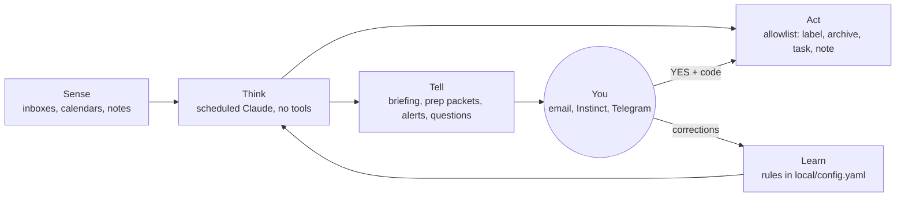

# Design

The agentic layer does three jobs:
- stays two steps ahead
- tells you what you need to know when you need it
- does the work you could do but shouldn't have to

It does them by reading widely and acting narrowly. Scheduled runs can read your mail headers, calendars and notes, but they can change only what a short allowlist names. Anything past that becomes a question to you, and your reply is what lets an action through.

## Architecture

| Layer | Code | What it can touch |
| --- | --- | --- |
| Sense | `acos/triage/providers.py`, `acos/meetings.py` | Mail headers, Gmail's short previews, calendars (read only), a notes folder you name |
| Think | `runner/run_job.sh` → `claude -p --tools ""` | Only the text it's handed. No files, no network, no tools. |
| Act | `providers.apply`, `approvals/actions.py` | Add a label or category, archive, add a task, save a note |
| Tell | `acos/deliver.py`, `approvals/channels.py` | Your inbox, your assistant's address, your own Telegram chat. Nothing else. |
| Learn | `local/config.yaml` | Updated in a live session when you correct something |

## Safety model

The limits live in what the code can do, not in instructions to the model. A prompt can be talked out of a rule; a missing function can't be called.

| Risk | Guard | Where it's enforced |
| --- | --- | --- |
| Mail gets lost | The mail code can label and archive. It has no trash, delete, send, forward or filter calls, and a test fails if one is added. Archived mail stays searchable. | `providers.py`, `tests/test_providers.py` |
| An email tells the agent to do something | Scheduled Claude runs get no tools (`--tools ""`). Mail and meeting material arrives as text marked as information only, so the worst a malicious email can do is change the wording of a briefing that goes to you. | `run_job.sh`, `tests/test_runner_and_meetings.py` |
| A fake approval | A reply counts only when it comes from the expected sender. Email checks: your own SENT mail, or SPF + DKIM passing for the sender's domain. Telegram checks: your own chat ID. It must also be in the ask's thread, say YES or NO plus an unused code, and arrive within 24 hours. Quoted text doesn't count. | `approvals/core.py`, `approvals/channels.py`, `tests/test_approvals.py` |
| An approved action goes too far | The action is fixed when the ask is sent and checked against an allowlist (`note`, `task_add`). The reply can't change it. | `core.validate_action`, `core.evaluate` |
| A message to someone else | Channels send only to you or your assistant, set in config. Replies to other people are drafted in a live session, never sent by a job. | `channels.py` |
| An assistant acts on an alert | Alerts to an assistant start with "Please text <name>:" and carry at most 300 characters of plain text, never quoted email. | `deliver.py` |
| Passwords and tokens | You sign in on Google's or Microsoft's page. Tokens are saved owner-only under `local/secrets/` and are never printed, committed or copied anywhere. | `auth.py`, `config.write_secret` |
| Third-party privacy | Instinct and Telegram see what passes through them, and Telegram bot chats aren't end-to-end encrypted. Alerts stay short; detail stays in email. | `deliver.py` |
| A bad first week | Every module starts in shadow mode and only reports. | `run_job.sh` modes |
| Overlapping or repeated runs | Each job holds a lock, and can run once per day, week or month, or only on a set date for trial runs. | `run_job.sh` |

## Modules

| Module | Schedule | Reads | Changes |
| --- | --- | --- | --- |
| Mail triage | Nightly | Headers of the last 2 days | Labels; archives receipts, newsletters, notifications |
| Approvals | Every 5 minutes | Replies in ask threads | Runs one allowlisted action per YES |
| Meeting prep | Evening before, and ~1 hour before | Calendars, recent threads with attendees, notes | Nothing; sends you a packet |
| Custom jobs | Your choice | What its `local/prompts/<job>.collect.sh` prints | Nothing; sends you a summary |

## Not yet built

- The morning briefing as a scheduled job. Today it comes from running `/cos` yourself.
- A guide for running on a cloud server instead of a laptop.
- Approvals through a Microsoft 365 mailbox. Today email and Instinct approvals use a Gmail inbox; Microsoft-only users can use Telegram.
